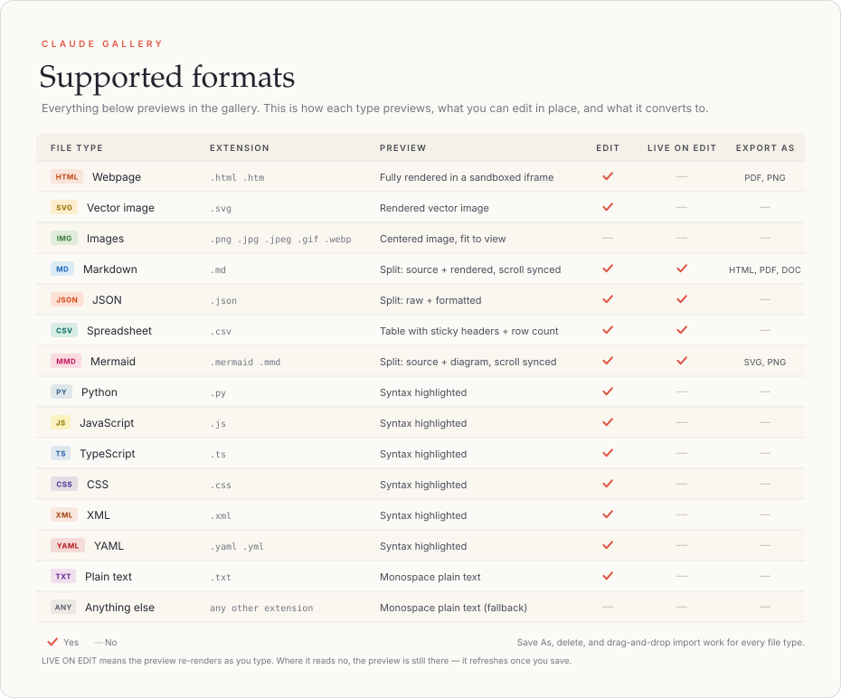

# Claude Gallery

A tiny local app that gives Claude Code in Kiro a live artifact viewer — so when Claude generates HTML, SVGs, charts, code, or data files, they appear in a browser gallery instantly.

## Supported Formats

## Install

### Windows
Download `ClaudeGallery-Setup.exe` from [Releases](https://github.com/HyperBioGhost/claude-gallery/releases/latest) and run it. Next → Next → Finish.

### Mac
Download `ClaudeGallery.pkg` from [Releases](https://github.com/HyperBioGhost/claude-gallery/releases/latest).

macOS will block the installer because it's not signed by Apple. To bypass:

**Option A** — Right-click (or Control + click) the `.pkg` file and choose "Open". The dialog will now have an "Open" button. Click it.

**Option B** — If Option A doesn't show an install option, go to **System Settings → Privacy & Security**, scroll down — you'll see "ClaudeGallery was blocked" with an "Open Anyway" button.

**Option C** (Terminal) — Type `sudo xattr -r -d com.apple.quarantine `, drag the `.pkg` into Terminal, press Enter. Then double-click to install.

## That's it

After installation:
- Claude Gallery runs silently in the background (auto-starts with your computer)
- Open the gallery anytime at **http://localhost:7477**
- Every time Claude generates something viewable, it appears there automatically

## How it works

- A small local server (~15MB RAM, 0% CPU when idle) runs on port 7477
- Claude Code is configured globally to send all generated artifacts to the gallery
- The browser uses a push connection (SSE) — no polling, no background activity
- Grid cards for HTML artifacts show a stored thumbnail rather than rendering every page on launch. A thumbnail refreshes only when you open, save or undo that artifact — until then it stays as it was, even if the file has changed
- **Collections** group related artifacts under one card: choose **Select…**, tick the artifacts, then **Add to collection**. Files never move on disk; collections are kept in `artifacts/collections.json`. Search and the type filters still reach artifacts inside collections. New artifacts always land on the homepage unless you ask Claude to put one in a collection. In the Add to collection window, type to find a collection (most recently used first) or to create one
- **Pins** keep an artifact or a collection above a thin line at the top: hover a card and click its pin, or use **Pin** in Select mode. A pin belongs to where the thing lives — the homepage, or the collection it is in — and stays there until you unpin it or move the artifact
- Going back from an artifact returns the grid to where you left it
- Only the gallery page itself can change artifacts: the server refuses requests from other websites open in your browser
- Editing an artifact snapshots the previous version first, so a save can be undone. Snapshots live in `artifacts/.history/` (last 10 per file)
- Activity and errors are logged to `ClaudeGallery/gallery.log` — attach it to a bug report
- On page load the gallery asks GitHub whether a newer release exists, and shows a pill if so. That is the only outbound request the app makes; set `CLAUDE_GALLERY_NO_UPDATE_CHECK=1` to turn it off

## Uninstall

Windows: Add/Remove Programs → Claude Gallery  
Mac: Run `sudo pkgutil --forget com.claude-gallery.server` and delete `/usr/local/bin/claude-gallery-server`

Both uninstallers cleanly remove the Claude Code configuration they added.
